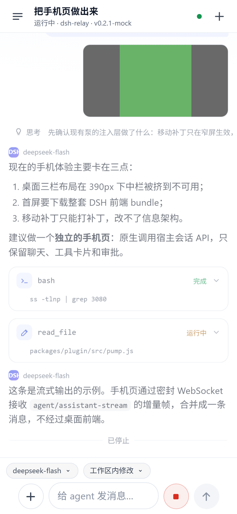
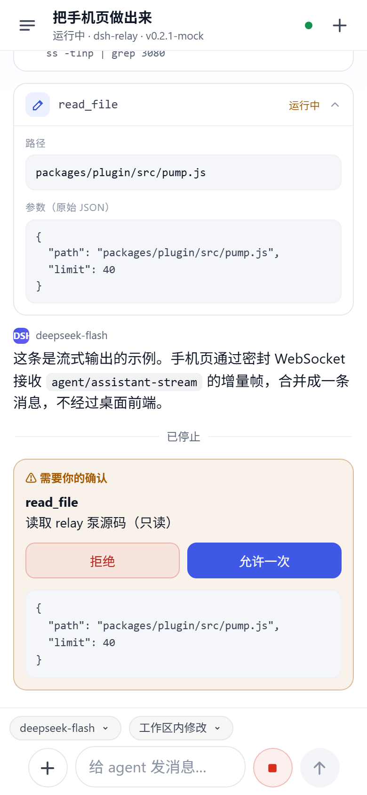
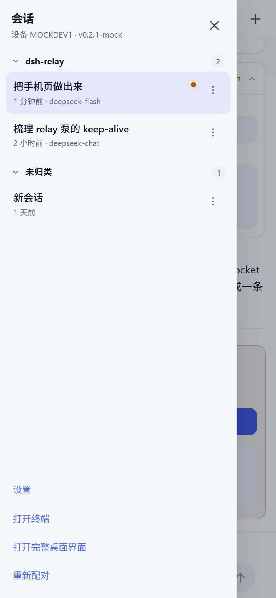

# dsh-relay

[](https://github.com/ebhrz/dsh-relay/actions/workflows/test.yml)

**Control the DeepSeek Harness (DSH) running on your own machine from your phone — through a relay you host yourself.**

No accounts, no third-party services, no inbound ports on your laptop, and the relay only ever sees ciphertext. Scan a QR code, get a phone-first page for chatting with your agent, approving tool calls, answering questions and streaming output; fall back to the full desktop UI when you need it.

**English** | [简体中文](README.md)

> **Free trial, no server needed:** open **<https://dshrelay.com:8443/>** and claim a
> **50 MB/day** relay key with one click. The page shows how many keys are left today
> (10 per day, resets at 00:00 UTC). Need more — or want to keep it — just email and
> say what you are using it for.

<p align="center">
  
  
  
</p>

On the phone you get:

- **Projects, not a flat list.** Sessions are grouped by workspace; groups collapse, and sessions outside a project fall into one bucket.
- **Model switching per session.** The chip above the composer opens a provider-grouped picker; a new session shows the deployment default instead of an empty prompt, and inherits the last model you picked.
- **Permission switching per session.** The chip beside it offers the host's presets (read only, workspace write, full access, plus auto review when mounted); full access is highlighted.
- **Branch a conversation.** Long-press a message (or use the row menu) to fork the history up to that point into a new session; the branch inherits the project and opens right away.
- **Choose what the transcript shows.** Settings gives reasoning and tool calls three states each — hidden, collapsed with a one-line preview, or expanded.
- Chat with streaming output, tool cards, approvals, questions, image attachments, renaming and a small terminal.

---

## Install (two steps, then scan)

> **No relay of your own?** Open **<https://dshrelay.com:8443/>**, claim a **50 MB/day** key with
> one click (10 a day, resets at 00:00 UTC, the page shows what is left), then skip to step ②.

### ① Relay: on your own VPS, or skip it

Using the trial above means **skipping this step**: in step ③ you fill in `dshrelay.com`, `8443`
and `9443`.

With a VPS of your own:

```sh
npm install -g dsh-relay-server     # or just npx dsh-relay-server …
dsh-relay-server --port 8889 --agent-port 9000 --data-dir ~/.dsh-relay
npx dsh-relay-server tenant add --name alice --quota 50MB   # prints her key once
```

Ports, TLS and per-tenant limits are covered in [relay details](#relay-details-run-your-own).

### ② Plugin: on the machine that runs DSH

**Desktop app, no terminal needed:** open the **Plugins** page → **Add plugin** → type
`dsh-relay-phone` in the package field → Enter → click **Enable now** → restart DSH when it asks
(the plugin is host-side code).

The same field takes a version (`dsh-relay-phone@0.11.10`), a git URL, a `.tgz` tarball or an
absolute local path, and lets you pick the registry (npm or a mainland mirror). Other plugins
update by uninstalling and reinstalling — there is no per-plugin "update" button.

**From a terminal:**

```sh
dsh plugin --profile web add dsh-relay-phone
```

From a checkout, point at the package instead:

```sh
cd dsh-relay
npm install --workspace dsh-relay-phone
dsh plugin --profile web add link:./packages/plugin
```

### ③ Pair

Sidebar **Phone Entry** → **Open console** → fill in the scheme, host, phone port, agent port and
the key from step ① → save → scan the QR code.

The console is **desktop-only**: it prints the pairing link, which carries the device key, so
requests that arrive through the relay are refused. In the desktop app that button navigates
same-origin, so the port does not matter; `dsh web` from a terminal prints the URL to append
`/relay-bridge/panel` to.

⚠️ **Through the relay only the phone page is plaintext** (plus the documents and assets it loads);
every other request must carry a sealed envelope or gets a 403. The reason is blunt: the relay is
both the TLS endpoint and the holder of your pairing ticket, so if it also forwarded plaintext
`/api/*` with your host cookie attached, it could act as you — which would make the end-to-end
encryption decorative. "Full desktop UI through the relay" is therefore off by default:

```json
// ~/.dsh/plugin-data/dsh-relay-phone/config.json
{ "allowDesktopPlaintext": true }
```

Turning it on means accepting that the relay operator can impersonate you. On a LAN, an SSH tunnel
or a VPN the desktop UI needs nothing special.

### Headless server (no desktop, no browser)

DSH is a Node service: `dsh web` binds loopback and never touches a display, so a remote box, a
container or a NAS runs it fine.

```sh
npm install -g @deepseek-ai/dsh           # needs Node ≥ 24.9
dsh web --host 127.0.0.1 --port 3080 --no-open
```

`--host` refuses wildcard addresses on purpose: to reach it from outside, either put the relay in
front (below) or forward the port with `ssh -L 3080:127.0.0.1:3080 server`.

Nobody can click a panel on a headless box, so configure the plugin by writing a file (either one,
no browser needed):

```sh
# A. the profile config layer, read by the plugin at boot
~/.dsh/profiles/web/cordis.patch.yml
- id: relay-bridge
  config: { relayScheme: https, relayHost: example.com, relayPort: 8443,
            agentPort: 9443, relayKey: "<key>", autoStart: true }

# B. the same file the console writes
~/.dsh/plugin-data/dsh-relay-phone/config.json
```

For the first pairing, either open one SSH tunnel and click the console (the QR code lives there),
or build `https://<relay>/c/<id>/?g=<gate>` from the `id` and `gate` in the plugin's
`identity.json` and send it to the phone.

Just want the machine to work, no UI at all: `dsh headless "run the tests"` answers one task and
prints the result — fine for cron. Note that `dsh plugin` shells out to **pnpm**, so install it on
the server first (`npm i -g pnpm`).

| Package | Runs on | Install | Upgrade |
|---|---|---|---|
| [`dsh-relay-server`](https://www.npmjs.com/package/dsh-relay-server) | your VPS | `npm install -g dsh-relay-server`, or just `npx dsh-relay-server` | `npm install -g dsh-relay-server@latest` |
| [`dsh-relay-phone`](https://www.npmjs.com/package/dsh-relay-phone) | the DSH machine | Plugins page → Add plugin → `dsh-relay-phone`; from a terminal, `dsh plugin --profile web add dsh-relay-phone` | uninstall and reinstall (or rerun the command), then restart DSH |

Requirements: the desktop app ships its own Node; installing DSH from npm needs **Node ≥ 24.9** (the
engine its package declares). Node ≥ 18 for the relay, which also needs a public IP and `openssl`
(it generates the agents' self-signed certificate).
`dsh-relay-server --version` prints the relay version; the console footer shows the plugin's.

## Relay details (run your own)

The relay only forwards bytes: plain HTTP on the phone side, WSS on the agent side (self-signed
certificate, pinned on first connect).

Open **two** ports: `8889` for phones and `9000` for agents. To terminate TLS in front of the phone
port, either pass `--tls-cert/--tls-key` (the relay then speaks HTTPS/WSS directly) or run the
included terminator behind a certificate you already have:

```sh
node packages/relay/src/tls-terminator.mjs --port 8443 --upstream 8889 --cert-dir /path/to/certs
```

⚠️ When a reverse proxy terminates TLS, start the relay with **`--host 127.0.0.1`**, or the
plaintext phone port is exposed to the internet as well (and `?g=` travels in clear text). The agent
listener has its own flag (`--agent-host`, default `0.0.0.0`) because outside agents must reach it.

Run either process under systemd, `tmux`, or your supervisor of choice. State is the generated agent
certificate plus `tenants.json` (keys as hashes, today's usage) in `~/.dsh-relay`.

Started with no key and no tenants, the relay idles and says so. Give each person their own key
(`npx dsh-relay-server …` works because the workspace is installed):

```sh
npx dsh-relay-server tenant add --name alice --quota 50MB --max-streams 32
# → prints alice's key once; that value goes into her DSH panel
```

Each tenant is held to, in this order:

1. **One agent at a time** — a second connection with the same key replaces the first.
2. **Concurrent stream cap** (`--max-streams-default`, 32) — the phone gets a `429` past it.
3. **Daily quota** (`--quota-default`, 50MB, UTC day) — cut at the limit, no re-registration until `tenant reset`.
4. **Disabled flag** — refused at `hello`, before a challenge is issued.

All of it is adjustable **while running**, no restart:

```sh
npx dsh-relay-server tenant list
npx dsh-relay-server tenant set alice --quota 200MB --max-streams 64
npx dsh-relay-server tenant set alice --max-streams 0        # unlimited
npx dsh-relay-server tenant disable alice
```

`0` means unlimited for either limit. Every flag and subcommand: [the relay README](packages/relay/README.md).

**For a relay other people use, also set a brake.** `--egress-limit 2GB` is a process-wide daily
byte cap that does **not** depend on the ledger — the admin key's traffic counts too — and once the
total crosses it, every connection is closed and the reason logged. Pick a number you would be
willing to pay once, and neither a bug nor a forgotten tenant can turn into a surprise bandwidth
bill:

```sh
npx dsh-relay-server --port 8889 --agent-port 9000 --egress-limit 2GB
```

**Single-user deployment**: no tenants at all, just one shared key. The admin path is not counted
against a tenant quota and has no stream cap:

```sh
KEY="$(openssl rand -hex 24)"
dsh-relay-server --port 8889 --agent-port 9000 --key "$KEY"
```

## The problem

DSH is a desktop harness: the agent runs on your machine, edits your files, and runs your commands. That is exactly what makes remote access awkward. You do not want to expose your laptop to the internet, you do not want your conversations sitting on someone else's server, and you do not want a mobile client that reimplements the agent.

dsh-relay splits the problem in three:

| Piece | Where it runs | What it does |
|---|---|---|
| `dsh-relay-server` | A small VPS you own | Dumb router: parses one request line, forwards bytes, stores nothing |
| `dsh-relay-phone` | Your machine, inside `dsh web` | Identity, pairing, encryption, replay to the local DSH |
| Phone page | Your phone's browser | Talks to the DSH host API through end-to-end encrypted frames |

## How it works

```
phone browser ──HTTP(S)──► dsh-relay-server (your VPS, dumb router)
                              │  WSS (self-signed TLS + pinned fingerprint + HMAC gate)
                              ▼
                    dsh-relay-phone (inside your dsh web)
                      ├─ auth gate: PSK challenge-response → encrypted cookie
                      ├─ mobile page:   /c/<id>/m + sealed RPC/WS → host session API
                      ├─ sealed pump:   Host/Origin rewrite, replay to ctx.webServer
                      ├─ boot injection: patched fetch/WS, all API and WS payloads sealed
                      └─ files:         /relay-bridge/files?p=<absolute path>
```

The bridge dials **out** to the relay, so your machine needs no public port and no inbound firewall rule. The relay pairs a phone connection with the agent's outbound connection by device id and shovels bytes between them; it never parses HTTP bodies, never terminates the envelope encryption, and keeps no database.

## Security model

| Layer | Mechanism |
|---|---|
| Relay abuse | Server starts with `--key`; an agent must prove knowledge of it with an HMAC challenge-response before registering |
| Per-user limits | Each tenant key has one agent slot, a concurrent-stream cap (`429` past it), and a daily byte quota that cuts the connection at the limit |
| Tenant isolation | A stream id is only valid on the connection that opened it: one tenant's agent cannot write into another tenant's phone stream or close it. Device ids are tenant-scoped, so two users may pick the same one |
| Scanner noise | Phone URLs carry `?g=<gate>`, derived from the device PSK; the relay drops requests without it before they reach your machine |
| Phone ↔ desktop auth | The QR fragment carries the PSK; a two-step challenge-response (replay-resistant) exchanges it for an encrypted ticket cookie valid for 30 days |
| Confidentiality | Every API request/response body and WebSocket frame is sealed with a key derived from the PSK (`tweetnacl` secretbox) |
| Relay ↔ desktop | Self-signed TLS with certificate pinning on first use (TOFU); if the fingerprint ever changes, the channel halts instead of reconnecting blindly |
| Revocation | "Regenerate" in the panel rotates the PSK, which invalidates every paired phone at once |
| Management console | `/relay-bridge/panel` and `/relay-bridge/api` are desktop-only: they print the pairing URL, which carries the PSK. The pump marks relayed requests, so a phone reaching the desktop UI still cannot open the panel |

**What the relay can see:** device ids, gates, connection metadata, request sizes and timing, and client IPs. Not your prompts, tool output, or file contents.

**Residual risks you should know about:**

- **Without TLS in front of the relay, the HTML/JS shell is delivered in clear text.** Encrypted API data does not help if an active man-in-the-middle can serve you different JavaScript. Put the relay behind a domain with TLS (Caddy is one line), or use a private network such as Tailscale. The threat model is "passive network observers and a curious relay operator", not "an attacker who can rewrite your traffic".
- The page shell is served by your own bridge over the relay, so anyone who can reach the relay *and* guess a device id still cannot pair without the PSK — but they will see the pairing page.
- A phone that has paired stays paired for 30 days. Rotate the identity when a device is lost.

## Configuration

Ordered by precedence: the panel's saved `config.json` wins over the defaults in `cordis.patch.yml`.

| Key | Default | Meaning |
|---|---|---|
| `relayScheme` | `http` | `http` or `https` for the phone-facing relay port |
| `relayHost` | — | Relay hostname or IP |
| `relayPort` | — | Relay phone port (e.g. `8889`) |
| `agentPort` | `relayPort + 1` | Relay agent port (e.g. `9000`) |
| `relayKey` | — | The key this deployment was given: a tenant key, or the server's admin `--key` |
| `autoStart` | `true` | Connect on startup; leave `false` to connect only from the panel |
| `dshHost` / `dshPort` | `127.0.0.1` / `3080` | Legacy fallbacks; the pump targets `ctx.webServer` when available |

State lives in `~/.dsh/plugin-data/dsh-relay-phone/` (`DSH_HOME` overrides `~/.dsh`): `identity.json`, `config.json`, `sessions.json`, `audit.log`. Deleting `identity.json` is equivalent to rotating the device identity.

## Repository layout

```
packages/relay/      dsh-relay-server — phone listener, agent listener, TLS terminator
packages/plugin/     dsh-relay-phone — identity, pairing, sealed pump, files, panel
  src/mobile/        phone page, host bridge, event folding, static assets
  src/client/        the small client bundle DSH loads in the browser
  test/              hermetic test suite (no relay, no dsh web)
  scripts/           mock host, CDP probes, live-environment probes
docs/mobile/         phone page design notes
```

## Development

Everything below runs without a relay or a running `dsh web`:

```sh
npm test          # compatibility, keep-alive, mobile patch, bridge, transport
npm run check     # node --check over every source file
npm run test:ui   # end-to-end UI test against the mock host (needs Chrome; skips if absent)
npm run dev:mock  # print a URL for the mock host, so you can open the phone page locally
```

The UI test and CDP probes need a Chromium-family browser; set `CHROME_BIN` if it is not in a standard location.

Probes that *do* need a real deployment read the local identity and take the relay URL from the environment:

```sh
RELAY_BASE_URL=https://relay.example.com:8889 node packages/plugin/scripts/probe-sealed.mjs
RELAY_BASE_URL=https://relay.example.com:8889 node packages/plugin/scripts/probe-ws.mjs
node packages/plugin/scripts/probe-relay-integration.mjs   # fake DSH behind a real relay client
```

## Compatibility

- **DSH**: `^0.2.1-rc.2`. The bridge uses the host services `webServer`, `connection`, `sessionController`, `userQuestions` and `terminals`; the boot injection targets the `{entries, batches}` boot payload introduced in 0.2.
- **Node.js**: ≥ 22 for the bridge (DSH's own floor), ≥ 18 for the relay.
- **Browsers**: any current mobile browser. The page is a single document plus three static assets.

## License

[Apache-2.0](LICENSE). See [NOTICE](NOTICE).
