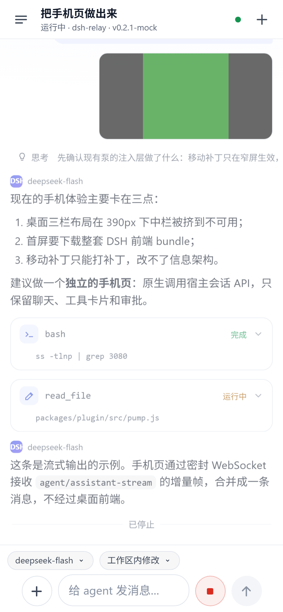
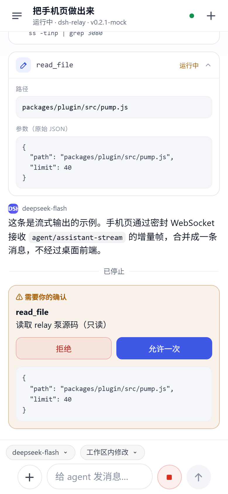
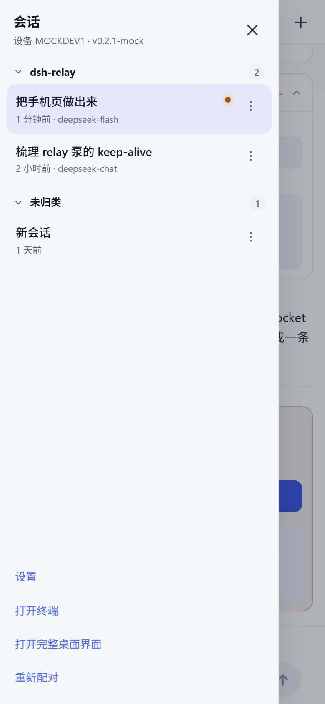

# dsh-relay

[](https://github.com/ebhrz/dsh-relay/actions/workflows/test.yml)

**用手机远程控制你自己机器上跑的 DeepSeek Harness（DSH）——经由你自己部署的中继服务器。**

零账号、零第三方服务、电脑不用开公网端口，中继全程只见密文。扫码即用：手机专用页面聊天、审批、
回答问题、看流式输出；需要完整功能时退回桌面界面。

[English](README.en.md) | 简体中文

> **免费试用，不用先搭服务器**：<https://dshrelay.com:8443/> 点一下领一把 50 MB/天的 key。
> 两步装完就能扫码，见下面的[安装](#安装两步装完就能扫码)。

<p align="center">
  
  
  
</p>

手机上你能得到：

- **按项目分组**：会话按 workspace 归组，组头可折叠，不属于任何项目的会话收在「未归类」。
- **按会话切换模型**：输入框上方的模型 chip 打开按 provider 分组的模型列表；新会话直接显示宿主默认模型（不会空着），并沿用你上一次手动选的那个。
- **按会话切换权限**：旁边的权限 chip 提供宿主的预设（仅可查看 / 工作区内修改 / 完全权限，挂载了自动审查时还有它），完全权限用警示色标出。
- **对话分叉**：长按某条消息（或用会话行菜单）把到那一点为止的历史复制成新会话，分支继承原项目并直接打开。
- **自己决定显示什么**：设置里思考过程和工具调用各有三档——隐藏、折叠（带一行预览）、展开。
- 聊天流式输出、工具卡片、审批、提问、图片附件、重命名和简易终端。

---

## 安装（两步，装完就能扫码）

> **不想自己搭中继**：先去 **<https://dshrelay.com:8443/>** 点一下，领一把 **50 MB/天** 的 key
> ——每天 10 把，UTC 0 点重置，页面实时显示还剩几把——然后从第 ② 步开始。

### ① 中继（relay）：用自己的服务器，或者跳过

用上面的免费试用就**跳过这一步**，第 ③ 步填 `dshrelay.com` / `8443` / `9443` 就行。

自己有 VPS 的话：

```sh
npm install -g dsh-relay-server     # 不想全局安装就用 npx dsh-relay-server …
dsh-relay-server --port 8889 --agent-port 9000 --data-dir ~/.dsh-relay
npx dsh-relay-server tenant add --name alice --quota 50MB   # 只打印一次 key
```

端口、TLS、租户上限这些细节在下面的[中继细节](#中继细节自建才需要)。

### ② 插件（plugin）：跑 DSH 的那台电脑

**桌面 App，不用命令行**：打开**插件**页 → 点「**添加插件**」→ 在包名框里输入
`dsh-relay-phone` → 回车 → 点「**立即启用**」→ 按提示**重启 DSH**（插件是宿主侧代码）。

这个框也接受带版本号（`dsh-relay-phone@0.11.10`）、Git 地址、`.tgz` 压缩包和本地绝对路径；
安装源可选 npm 官方或大陆镜像。别的插件升级是「卸载再装」，没有单独的更新按钮。

**命令行**：

```sh
dsh plugin --profile web add dsh-relay-phone
```

从仓库源码安装就把包名换成路径：

```sh
cd dsh-relay
npm install --workspace dsh-relay-phone
dsh plugin --profile web add link:./packages/plugin
```

### ③ 配对

侧边栏「**手机入口**」→ 卡片里「**去控制台配置**」/「**打开完整控制台**」→ 填协议、地址、
手机端口、agent 端口和第 ① 步的 key → 保存后扫码。

面板是**桌面专用**的：它会打印带设备密钥的配对链接，所以走中继过来的请求一律拒绝。桌面 App
里点那个按钮是同源跳转，**不需要知道端口**；命令行启动的 `dsh web` 用它打印的地址加
`/relay-bridge/panel`。

⚠️ **走中继时只有手机页**（和它加载的文档/静态资源）是明文；其余请求必须带加密信封，否则直接
403。原因很硬：中继既是 TLS 终点、又看得到配对票据，如果它还愿意替你转发明文 `/api/*` 并附上
本机 Cookie，那它就能以你的身份操作这台 DSH——端到端加密就白做了。所以「完整桌面界面走中继」
默认关闭，需要时显式打开：

```json
// ~/.dsh/plugin-data/dsh-relay-phone/config.json
{ "allowDesktopPlaintext": true }
```

桌面界面在严格策略下是**可用**的：它的 `fetch`/XHR/WebSocket 都被 boot patch 加了信封，WebSocket 握手本身不带数据所以放行、帧仍然必须解密通过。这个开关只留给绕过了 patch 的客户端（旧客户端、自己写的脚本）。打开就等于接受"中继运营者可以冒充我"。

### 无头服务器（没有桌面、没有浏览器）

DSH 本体就是 Node 服务，`dsh web` 只绑定 loopback，不碰显示器——所以远程机器、容器、NAS 上都能跑：

```sh
npm install -g @deepseek-ai/dsh           # 需要 Node ≥ 24.9
dsh web --host 127.0.0.1 --port 3080 --no-open
```

`--host` 不接受通配地址，这是有意的：想从外面访问，要么走中继（下面这条），要么
`ssh -L 3080:127.0.0.1:3080 服务器` 把端口拉到本地浏览器。

无头机上没法点面板，所以配置直接写文件（二选一，都不需要浏览器）：

```sh
# A. profile 配置层——启动时由插件读进配置
~/.dsh/profiles/web/cordis.patch.yml
- id: relay-bridge
  config: { relayScheme: https, relayHost: example.com, relayPort: 8443,
            agentPort: 9443, relayKey: "<key>", autoStart: true }

# B. 插件自己的配置——面板写入的同一个文件
~/.dsh/plugin-data/dsh-relay-phone/config.json
```

第一次配对要么开一次 SSH 隧道点一下面板（二维码就在那儿），要么把 identity 里的
`id` / `gate` 拼成 `https://<relay>/c/<id>/?g=<gate>` 发给手机。

只想让机器干活、不要界面：`dsh headless "跑一遍测试"` 一次性执行并打印结果，适合 cron。
另外，`dsh plugin` 背后调用 **pnpm**，无头机记得先 `npm i -g pnpm`。

| 包 | 跑在哪 | 安装 | 升级 |
|---|---|---|---|
| [`dsh-relay-server`](https://www.npmjs.com/package/dsh-relay-server) | 你的 VPS | `npm install -g dsh-relay-server`，或直接用 `npx dsh-relay-server` | `npm install -g dsh-relay-server@latest` |
| [`dsh-relay-phone`](https://www.npmjs.com/package/dsh-relay-phone) | 跑 DSH 的机器 | 插件页「添加插件」填 `dsh-relay-phone`；命令行是 `dsh plugin --profile web add dsh-relay-phone` | 卸载再装（或重复同一命令），然后重启 DSH |

环境要求：桌面 App 自带 Node；从 npm 装 DSH 需要 **Node ≥ 24.9**（包里声明的引擎）。中继 Node ≥ 18，
要有公网 IP，并且有 `openssl`（生成 agent 自签证书）。`dsh-relay-server --version` 打印中继版本，
插件版本看面板页脚。

## 中继细节（自建才需要）

中继只做字节转发：手机侧是普通 HTTP，agent 侧是 WSS（自签证书，首个连接 TOFU 记住指纹）。

开放**两个**端口：`8889` 给手机，`9000` 给 agent。要在手机侧终止 TLS，有两种方式：
给中继传 `--tls-cert/--tls-key`（中继自己讲 HTTPS/WSS），或者用附带的终结器接你已有的证书：

```sh
node packages/relay/src/tls-terminator.mjs --port 8443 --upstream 8889 --cert-dir /path/to/certs
```

⚠️ 用反向代理终止 TLS 时，**给中继加 `--host 127.0.0.1`**，否则明文手机端口会一起暴露在公网
（`?g=` 会明文走线）。agent 端口是另一个参数（`--agent-host`），默认 `0.0.0.0`——它必须让外面的
agent 连进来。

用 systemd / tmux / 你惯用的守护方式常驻即可。状态只有自动生成的 agent 证书和
`tenants.json`（只存 key 的哈希和当天用量）。

不带 `--key`、也还没建租户时，中继会空转并提示。给每个人发一把自己的 key：

```sh
npx dsh-relay-server tenant add --name alice --quota 50MB --max-streams 32
# → 只打印一次 alice 的 key，填进她 DSH 面板的 relay key 字段
```

每个租户按顺序受这些约束：

1. **同时只有一个 agent** —— 同一个 key 再连一条，旧的会被踢掉。
2. **并发 stream 上限**（`--max-streams-default`，默认 32）—— 超了手机侧收到 `429`。
3. **每日流量配额**（`--quota-default`，默认 50MB，按 UTC 日）—— 到量即断，当天不能再注册，除非 `tenant reset`。
4. **停用标记** —— 在 `hello` 阶段就拒绝，连挑战都不发。

全部可以在**运行中**调整，不需要重启：

```sh
npx dsh-relay-server tenant list
npx dsh-relay-server tenant set alice --quota 200MB --max-streams 64
npx dsh-relay-server tenant set alice --max-streams 0        # 不限
npx dsh-relay-server tenant disable alice
```

两个上限都可以写 `0` 表示不限。完整参数和子命令见[中继的 README](packages/relay/README.md)。

**要给别人用的中继，再加一道闸。** `--egress-limit 2GB` 是进程级的每日总字节上限，**不依赖租户
账本**，admin key 的流量也计入：总量一到就断开所有连接并记录原因。挑一个「就算付一次也无所谓」的
数字，那么无论是代码 bug 还是忘了删的租户，都不会变成一张意外的带宽账单：

```sh
npx dsh-relay-server --port 8889 --agent-port 9000 --egress-limit 2GB
```

**单人部署**：完全不用租户，只留一把共享 key；admin 路径不计租户流量、不限并发：

```sh
KEY="$(openssl rand -hex 24)"
dsh-relay-server --port 8889 --agent-port 9000 --key "$KEY"
```

## 要解决什么

DSH 是桌面工具：agent 跑在你自己机器上，改你的文件、跑你的命令。这恰好让远程访问变得棘手——
你不想把笔记本暴露到公网，不想让对话留在别人服务器上，也不想为手机端重写一遍 agent。

dsh-relay 把它拆成三块：

| 组件 | 运行位置 | 职责 |
|---|---|---|
| `dsh-relay-server` | 你自己的小服务器 | 哑路由：只解析请求首行，转发字节，不存任何数据 |
| `dsh-relay-phone` | 你的机器，跑在 `dsh web` 里 | 设备身份、配对、加密、回放到本机 DSH |
| 手机页 | 手机浏览器 | 通过端到端加密帧直接调用 DSH 宿主 API |

## 工作原理

```
手机浏览器 ──HTTP(S)──► dsh-relay-server（你的服务器，哑路由）
                          │  WSS（自签 TLS + 指纹钉住 + HMAC 注册门）
                          ▼
                dsh-relay-phone（跑在你的 dsh web 里）
                  ├─ 认证门：PSK 挑战-应答 → 密文 cookie 票据
                  ├─ 手机页：/c/<id>/m + 密封 RPC/WS → 宿主会话 API
                  ├─ 密封泵：Host/Origin 改写回放 → 本进程 webServer 端口
                  ├─ boot 注入：fetch/WS 补丁，API 与 WS 载荷全部密封
                  └─ 文件：/relay-bridge/files?p=<绝对路径>
```

桥接端是**主动外连**到中继的，所以你的电脑不需要公网端口、不需要入站防火墙规则。
中继按设备 id 把手机连接和 agent 的外连配对起来，然后双向搬运字节：不解析 HTTP body，
不参与信封加密，也不保存数据库。

## 安全模型

| 层 | 机制 |
|---|---|
| 防中继被白嫖 | 中继以 `--key` 启动，agent 注册需 HMAC 挑战-应答证明 |
| 每用户限额 | 每把租户 key 一个 agent 名额、一个并发 stream 上限（超了 `429`）、一个每日流量配额（到量即断） |
| 租户隔离 | 流 id 按连接校验：一个租户的 agent 不能往别人的手机流里写字节、也不能关掉它；设备 id 按租户区分，两人撞名互不影响 |
| 密文重放 | 每个信封带随机 nonce，宿主记住已解开过的 nonce（5 万条上限），重复投递按解密失败处理；客户端对响应做同样的事（2 万条）|
| 防扫描打扰 | 手机 URL 携带 `?g=<gate>`（由 PSK 派生），中继校验通过才转发到你的机器 |
| 手机↔电脑认证 | 二维码 fragment 携带 PSK，两步挑战-应答（防重放）换取密文 cookie，有效期 30 天 |
| 数据机密性 | 由 PSK 派生信封密钥，所有 API 请求/响应体 + WS 帧用 tweetnacl secretbox 密封 |
| 中继↔电脑 | 自签 TLS + 首次连接指纹钉住（TOFU）；指纹变化即拒绝连接，而不是盲目重连 |
| 吊销 | 面板点「重新生成」= 轮换 PSK = 所有已配对手机立即失效 |
| 管理面板 | `/relay-bridge/panel` 和 `/relay-bridge/api` 只在桌面可用：它们会打印带 PSK 的配对链接。pump 会给中转请求打标记，所以手机即使打开了桌面界面也拿不到面板 |

**中继能看到什么**：设备 id、gate、连接元数据、请求大小与时间、客户端 IP。看不到你的提问、
工具输出和文件内容。

**已知残余风险：**

- **不在中继前面加 TLS 时，HTML/JS 外壳是明文投送的。** 如果主动中间人可以给你换成别的 JavaScript，
  加密 API 数据也救不了。给中继配域名 + TLS（Caddy 一行），或让手机走 Tailscale 之类的私有网络。
  威胁模型是「被动监听者 + 好奇的中继运营者」，不包括「能改写你流量的攻击者」。
- 页面外壳由你自己的桥接端生成并经中继投送，所以即使有人能访问中继并猜到设备 id，没有 PSK 也无法完成配对，
  但会看到配对页。
- 已配对的手机 30 天内保持有效。设备丢失时请轮换身份。

## 配置

优先级：面板保存的 `config.json` 覆盖 `cordis.patch.yml` 里的默认值。

| 配置项 | 默认值 | 含义 |
|---|---|---|
| `relayScheme` | `http` | 手机侧协议：`http` 或 `https` |
| `relayHost` | — | 中继域名或 IP |
| `relayPort` | — | 中继手机端口（如 `8889`） |
| `agentPort` | `relayPort + 1` | 中继 agent 端口（如 `9000`） |
| `relayKey` | — | 共享 key，需与中继 `--key` 一致 |
| `autoStart` | `true` | 启动即连接；设为 `false` 则只在面板里手动连接 |
| `dshHost` / `dshPort` | `127.0.0.1` / `3080` | 兼容用回退值；可用时泵以 `ctx.webServer` 为准 |

状态目录：`~/.dsh/plugin-data/dsh-relay-phone/`（`DSH_HOME` 可覆盖 `~/.dsh`），包含
`identity.json`、`config.json`、`sessions.json`、`audit.log`。删除 `identity.json`
等同于轮换设备身份。

## 目录

```
packages/relay/      dsh-relay-server：手机监听、agent 监听、TLS 终结器
packages/plugin/     dsh-relay-phone：身份、配对、密封泵、文件、面板
  src/mobile/        手机页、宿主桥接、事件折叠、静态资源
  src/client/        DSH 加载的小型客户端 bundle
  test/              纯 loopback 测试（不需要中继，也不需要 dsh web）
  scripts/           mock 宿主、CDP 探针、真实环境探针
docs/mobile/         手机页设计说明
```

## 开发

下面这些都不需要中继或运行中的 `dsh web`：

```sh
npm test          # 兼容性、keep-alive、移动补丁、宿主桥接、传输层
npm run check     # 对每个源文件跑 node --check
npm run test:ui   # 针对 mock 宿主的端到端 UI 测试（需要 Chrome，缺失则跳过）
npm run dev:mock  # 打印 mock 宿主 URL，本地打开手机页
```

UI 测试与 CDP 探针需要 Chromium 系浏览器；不在标准路径时用 `CHROME_BIN` 指定。

需要真实部署的探针从环境变量取中继地址、从本机读身份：

```sh
RELAY_BASE_URL=https://relay.example.com:8889 node packages/plugin/scripts/probe-sealed.mjs
RELAY_BASE_URL=https://relay.example.com:8889 node packages/plugin/scripts/probe-ws.mjs
node packages/plugin/scripts/probe-relay-integration.mjs   # 假 DSH + 真 relay 客户端
```

## 兼容性

- **DSH**：`^0.2.1-rc.2`。桥接使用 `webServer`、`connection`、`sessionController`、
  `userQuestions`、`terminals` 等宿主服务；boot 注入针对 0.2 引入的 `{entries, batches}` 结构。
- **Node.js**：桥接 ≥ 22（DSH 自身的下限），中继 ≥ 18。
- **浏览器**：任意现代手机浏览器。页面是一个文档加三个静态资源。

### 0.2 升级要点（历史记录）

如果从 0.1 时代升级过来，这些差异解释了早期版本的行为：

- 浏览器鉴权：`/` 与 `/api` 需要由启动 token 换取的 cookie，泵在宿主侧静默换取并注入回放请求。
- 启动图：`window.__DSH_BOOT__` 从 `{plugins}` 变为 `{entries, batches}`，插件 combo URL 是文档相对形式。
- 终端：relay 自带的 tmux/xterm 终端已移除，改用 DSH 自带的右侧栏终端。
- WebSocket：`/api/remote.mux` 只接受 text 帧，泵把解密后的手机帧以 text 重封装。
- 端口：DSH 0.2 可能绑定随机端口，泵读 `ctx.webServer.port`，面板里的端口只读展示。

## 许可

[Apache-2.0](LICENSE)，见 [NOTICE](NOTICE)。
