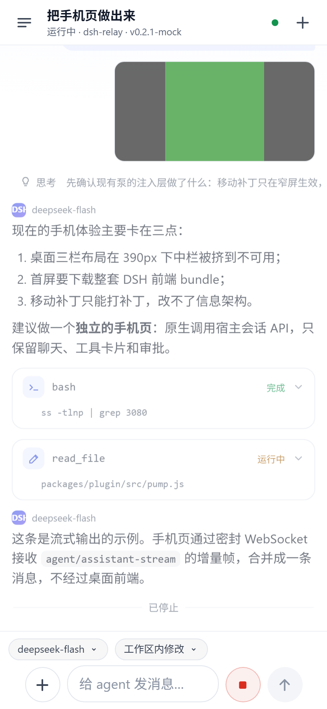

# 手机页（DSH Remote）— 设计与实现

手机专用页面，替代"把桌面 DSH 三栏界面塞进手机"的旧路径。页面由 `dsh-relay-bridge`
自己提供，后端直接调用 DSH **原生会话 API**（`ctx.sessionController`），不经过桌面前端
bundle、不解析 DOM、不重放整个 web UI。

入口：`https://<relay>/c/<设备id>/m?g=<gate>#k=<配对密钥>`（面板二维码即该地址）。



## 1. 为什么另起一页

桌面界面经泵回放的主要问题：

| 问题 | 旧路径 | 手机页 |
|---|---|---|
| 布局 | 三栏在 390px 下中栏被挤到 ~110px，只能靠注入补丁打补丁 | 单栏，单手可操作 |
| 首屏 | 整套 DSH 前端 bundle（几十个请求） | ~100KB（未压缩）HTML/JS/CSS + 共享 nacl，5 个静态请求 |
| 能力 | 全量功能，但手机用不到 | 会话列表、聊天、流式输出、工具卡片、审批、提问、停止 |
| 协议 | 回放 DSH HTTP/WS + boot 注入 | 插件自有 JSON RPC + 密封 WS，宿主内直接调 `sessionController` |

桌面完整界面仍然保留：访问 `/c/<id>/?g=...` 时，手机 UA 默认 302 到 `/m`；加
`?desktop=1` 或使用桌面浏览器仍进入完整界面。手机页抽屉底部也有「打开完整桌面界面」。

## 2. 传输与安全

```
手机页面  ──fetch /__relay/m/rpc (x-relay-enc 密封)──►  pump（本地路由）──► MobileBridge
          ──WS   /__relay/m/ws  (密封 JSON 帧)──►       MobileRouter   ──► ctx.sessionController
```

- **认证不变**：仍是配对票据 cookie（`__relay_t`），未配对请求由泵返回配对页。
- **页面与静态资源**：和 DSH HTML 一样走明文投送（无 TLS 模式的既有残余风险），
  但 API 数据、流式输出、工具结果全部走 `nacl.secretbox` 信封密封。
- **本地路由**：`/m*`、`/__relay/m/rpc`、`/__relay/m/ws` 在泵里直接截获，不转发给 DSH
  上游；WebSocket 由插件自己完成 101 握手，复用 `ws-codec.js`。
- **静态资源缓存**：HTML `no-store`，`app.js/app.css/nacl.js` 带内容哈希 + `immutable`。
- **`/m` 只接受配对后访问**；WS 路径同样要求票据。

## 3. 宿主侧 API 契约

`packages/plugin/src/mobile/bridge.js`：

| RPC / 事件 | 宿主调用 | 说明 |
|---|---|---|
| `sessions` | `sessionController.list({})` + `workspaceRegistry.list()` | 过滤 subagent / 归档，带标题、cwd、running、模型；同时返回项目分组（workspace 的有序 `sessionIds`） |
| WS `subscribe` | `sessionController.follow({address,assistantStream:true,maxMessages:40})` | 快照 + 无洞事件 + 实时 token 流；冷会话会被 promote |
| `older` | `sessionController.page({throughSeq,beforeSeq})` | 向上翻历史，不激活 agent |
| `prompt` | `sessionController.prompt({requestId,sessionId,mode,content,clientTimeZone})` | 内含冷会话 resume；`requestId` 幂等 |
| `stop` | `sessionController.cancel({sessionId})` | 仅对 live agent 有效 |
| `create` / `rename` / `model.catalog` / `model.select` | 对应 controller 方法 | 新建会话、改标题、模型目录/选择 |
| `fork` | `sessionController.fork({sessionId, atSeq?})` | 把事件前缀（含切点）复制成新会话；省略 `atSeq` 取最近已结束回合，新会话自动挂回原项目 |
| `permission.catalog` | `ctx.permissionPresets.catalog()` | 进程级权限预设（只读 / 工作区可写 / 完全权限，挂载 Auto 时还有 `auto`），带 `defaultPreset` |
| `permission.set` | `ctx.permissionPresets.set(session, preset)` | 只改当前会话：追加 `permission/preset`，再经沙箱与审批各自的 setter 写两个旋钮 |
| WS `permission` | `permissions` 投影 + `permission/preset`、`sandbox/mode`、`approval/policy`、`session/end-seed` 事件 | 手机上的权限 chip 据此更新，不必等下一次快照 |
| （内部）`projections` | `sessionController.projections({sessionId}, signal)` | follow 快照的 `projections` 为空时补读一次 `permissions`，冷会话也能显示当前预设。**必须传 `signal`**：它在入口就调用 `signal.throwIfAborted()`，不传会直接抛错 |
| 投影取值形状 | 该投影的 `wire.view` 是 `({ currentValue }) => ({ currentValue: derive(state) })` | **客户端拿到的是 `{currentValue: "<preset>"}`**，不是宿主内部的 `{preset, sandbox, approval, seeded}`。按后者读会得到"全是 null"，chip 就只剩「权限」 |
| `interaction.answer` / `interaction.cancel` | 审批 → `approval/request` waterfall 的返回值；提问 → `userQuestions.answer`（continued 时） | 手机优先，见下 |
| `image.get` | `sessionController.attachment({sessionId,attachmentId})` | 消息里的图片内联渲染 |
| `terminal.list/create/read/send/cancel/close` | preset 的 `terminals.list/spawn/read/startSend/signal/kill`；没有该注册表时回退 `ctx.subprocess.spawnTerminal` + 插件自持缓冲 | 手机终端（轮询 scrollback） |
| 事件 | `session/event`、`agent/assistant-stream`、`agent/status`、`api-session/*` | 折叠后推送 UI 行 |

**0.2.1 的 `prompt` / `page` / `follow` 会在入口调用 `signal.throwIfAborted()`**，插件必须传真实的
`AbortSignal`（桥内共享一个，dispose 时 abort）；传 `undefined` 会在宿主内部抛
`Cannot read properties of undefined (reading 'throwIfAborted')`。

审批 / 提问采用 **waterfall 前置监听 + 手机优先**：

- 有手机正看着该会话 → 拦住请求，推卡片，等手机回答；**等待期间不调用 `next()`**
  （审批没有宿主超时，提前放行会让桌面/失败关闭抢先）。
- 没有手机观看 → `next()` 交回桌面链路。
- 手机断开/审批超时（10 分钟）→ 以 `cancelled` 结算，避免 turn 永久挂起。
- 提问：timed 请求用 `userQuestions.attachWait()` 占用等待窗口；「稍后回答」把问题留到
  `continued`，之后用 `userQuestions.answer(liveAgent, callId, answers)` 补答。

持久化事件折叠规则（`fold.js`）：只渲染 append-origin surface 事件；`tool/call` 与
`tool/result` 按 `callId` 合并成卡片；未知事件/内容块直接跳过；注入上下文
（`source.kind !== 'user'`）不伪装成用户气泡。

## 4. 手机页能力

- 会话抽屉：**按项目（workspace）分组**，组头可折叠并显示会话数；未归属任何项目的会话收在「未归类」；
  宿主没有 workspace 注册表时退回平铺列表。行内显示标题、工作目录、相对时间、模型、运行中 / 需要审批的圆点，
  分叉出来的会话带「分支」标记。
- 会话操作：每行右侧「⋯」→ 切换模型 / 重命名 / 分叉会话 / 复制工作目录。
- 对话分叉：**长按任意用户或助手消息** →「从此处分叉」复制到该条为止的对话；行菜单里的「分叉会话」
  从最近一个已结束回合分叉。分叉后自动打开新会话，并保留原项目的归属。
- 聊天流：用户气泡、助手 Markdown（代码块/表格/列表/引用）、思考折叠、工具卡片
  （参数/输出/状态）、错误与停止/压缩分隔。折叠状态下也会显示**一行预览**：
  思考取开头几十个字，工具取命令 / 路径 / 参数，不用点开就知道跑了什么。
- 工具卡片**整张可点**（标题、预览、状态都行，只有展开后的 `<pre>` 里保留选中文字），
  右上角有折叠箭头。展开后先给一块**原样命令 / 路径**（`command`、`path`、`pattern`、`query`、
  `url` 里第一个命中的字段），再给原始 JSON 参数——JSON 里的 `\"` 转义在手机上很难读。
- 思考过程**流式显示**：`assistant-stream` 的 `reasoning-delta` 一到达就渲染在回复上方
  （带「思考中…」和打字光标、自带上限滚动），不用等这一轮结束；回合提交后才折成普通的
  思考行，那时才受「折叠 / 展开」设置约束（「隐藏」对流式内容同样生效）。
- 设置面板（抽屉底部「设置」）：只看**显示偏好**，属于这台手机。
  - 思考过程、工具调用各有 **隐藏 / 折叠 / 展开** 三档，存在本地 `localStorage`；
    「展开」让新行默认打开，「隐藏」则完全不渲染。三档只作用于**已完成**的消息，
    正在流式输出的思考始终可见。
- 权限（模型 chip 旁边的权限 chip）：**按会话**，所以不放在「抽屉」那个全局入口里。
  - 直接读宿主 `permissionPresets` 的预设（仅可查看 / 工作区内修改 / 完全权限，
    挂载 Auto review 时还有自动审查），点一下调用 `permission.set`，只影响当前会话；
    完全权限时 chip 会变成警示色。宿主没有挂载该服务时会说明只能在桌面端设置。
  - 只要打开着会话就显示这个 chip：状态还没到时显示「权限」，`permission` 帧到达后
    换成具体预设。**follow 快照的 `projections` 可能为空**（冷会话常见），桥会额外调用一次
    `sessionController.projections({sessionId})` 把 `permissions` 读回来。
- 主题：**浅色为默认**，与 DSH 桌面保持一致；原来的深色（黑底 + 蓝紫强调）作为夜间模式。
  抽屉「设置 → 外观 → 主题」可选 `系统 / 浅色 / 夜间`（存在 `localStorage`，默认跟随系统）。
  选择在 `<head>` 里的内联脚本里应用（读同一个 setting 键），所以首屏不会闪一下错误配色；
  `theme-color` 也跟着切。所有颜色都是 `:root` 里的 token，夜间块由 `:root[data-theme="dark"]`
  切换，两套调色板共用同一套规则。配对页和桌面控制台是浅色默认 + `prefers-color-scheme`。
  DSH 侧边栏里的「手机入口」卡片在挂载时**采样宿主背景色**（DSH 没有暴露调色板 token），
  浅色宿主就用浅色卡片，换成深色宿主自动跟随。
- 流式输出：`assistant-stream` 增量渲染，带光标；快照可恢复中途断线时的半截文本。
- 审批卡片：工具名 + 原因 + 参数，拒绝 / 允许一次。
- 提问卡片：单选/多选/自定义输入；超时后仍可补答。
- 模型选择：输入框上方模型 chip，点开按 provider 分组选择（`sessionController.modelCatalog/selectModel`）。
  新会话自己还没有选择时，chip 显示**宿主默认值**（部署里 `agent-default-model` 的配置，
  默认 `deepseek / deepseek-flash`），不会出现空的「请选择模型」；手动选过的模型宿主会记成
  默认值（`agentDefaultModel.saveSelection`），手机同时把最后一次选择写进 `localStorage`。
- 图片：相册/拍照选择图片（自动缩放到 1600px、JPEG），随 prompt 一起发送；历史与回复中的
  `image` 块通过 `session/attachment` 拉取后内联渲染，可点开全屏查看。
- 终端：会话抽屉「打开终端」进入手机终端（列出/新建 PTY、轮询 scrollback、回车执行、Ctrl-C、关闭）。
  会话 preset 挂了 `terminals` 注册表时直接用（minimal 等）；`standard` 这类不挂载 preset 的
  会话，插件用宿主 `subprocess.spawnTerminal` 自己开一个 PTY，因此任何会话都有终端。
  DSH 桌面终端仍可在完整界面使用。
  面板不是终端模拟器（只是 <pre> 行缓冲），所以显示前会把 shell 的 VT 控制序列
  （CSI/OSC/裸 ESC、\r）剥掉，只留可读文本；线上传输的仍是原始字节，将来换真终端不用改协议。
- 输入区：模型 chip 与权限 chip 同行（权限 chip 直接打开按会话的权限面板），下面是「+ 附件 / 输入框 / 停止 / 发送」，任何屏宽下发送键都可见；
  自适应高度；触屏键盘 Enter 换行、只由发送按钮提交（避免手机键盘没有 Shift）；
  接硬件键盘时 Enter 发送、Shift+Enter 换行；运行中显示停止键。
- 键盘适配（最终方案）：**不预测键盘、不滚页面、只纠正偏差**。
  1. `.app` 在文档里（`position: absolute; top: 0; height: <布局高度>`），输入框在它的底部；
  2. 聚焦时记住"可视高度"的最大值并写进 `localStorage`（key `dshRelayVisibleHint`）；
     键盘不会变，但页面拿到的数会变——同一台机器同一键盘，报过 332（正确）和 174，
     对应系统自己滚 322（输入框正好在键盘上沿）和 480（输入框跑到屏幕中间）。偏大的
     滚动永远来自偏小的可视高度，所以取最大值最近真；
  3. 用**变换**而不是滚动来纠正：
     `translateY(scroll − (布局高度 − 可视高度))`，让 app 的底边（输入框）落到可视区下沿。
     `transform` 不改变布局，也不依赖文档可滚动，系统滚多少都能拉回来；
  4. 失焦把 transform 清零，并 `scrollTo(0, 0)`。
  教训：`visualViewport` 在这台设备上四次会话报 104/157/174/332，任何拿它当尺寸的写法
  都会在某些会话里出错；`position: fixed` 还会被 iOS 的整页滚动带着走（`sy=497` 时连
  `#debug` 那条 fixed 都跑到了屏幕中间）。所以整页只用绝对定位 + 变换纠偏。
  同步是 **去抖 220ms + 聚焦后延迟应用 + 聚焦/失焦 + 横竖屏 + 输入中每 700ms 重申**。
- `blur` 不冒泡，所以除了 `focusout` 还要在捕获阶段监听，否则收起键盘后不会复位。
- 手机地址后面加 `#debug` 会在页面顶部显示 `ih / vv / off / hint / shift / sy / focus / perm`
  实时数值；不带 hash 时不会创建任何节点，**也不向任何地方上报**。它挂在 `.app` 内部，
  所以 iOS 的整页滚动不会像 `fixed` 那样把它带走。
- 工具卡片的展开状态**按会话记在 `Set` 里**，因为宿主每次更新工具状态都会下发新的
  item，页面要重建节点；只存在 item 对象上的 `open` 会随之丢失（表现是"点开了又弹回去"）。
- 历史：滚动到顶自动加载更早消息并保持滚动位置；「回到最新」浮标。
- 连接状态：圆点 + 断线重连 + 顶部提示；WS 自动重订阅当前会话。
- 安全区、键盘（`visualViewport` / `interactive-widget`）、iOS 16px 防聚焦缩放。
- PWA 基础：theme-color、icon、viewport-fit=cover。

## 5. 测试

```bash
cd packages/plugin
node test/mobile-transport.test.mjs   # 纯 loopback：配对门、页面/资源、密封 RPC、密封 WS、302
node test/mobile-bridge.test.mjs      # 假 Cordis ctx：sessionController 调用、折叠、审批/提问 waterfall
node test/mobile-ui.test.mjs          # mock 宿主 + headless Chrome：加载/抽屉/审批/提问/发送/流式/停止 + 截图
node scripts/mobile-mock.mjs          # 手动在浏览器里玩 mock 手机页（打印 URL）
```

`test-mobile-ui.mjs` 的截图写到 `packages/plugin/.tmp/mobile-ui/`（已 gitignore），
本目录 `shots/mobile-*.png` 是其中代表状态。

## 6. 真机前验证（隔离 0.2.1 实例）

除 mock UI 测试外，本次修复还在一个**隔离的 dsh web 0.2.1 实例**（独立 DSH_HOME + 本地
relay，未触碰用户运行中的实例）上跑通了真实链路：

```
follow 快照（82 条历史、cursor 1916）→ page 向前翻页（42 条）
prompt 缺失会话 → session/not-found（证明 AbortSignal 已正确传入，不再 throwIfAborted）
model.catalog → 2 个 provider / 2 个可路由分组
image.get 不存在附件 → session/attachment-invalid（干净错误）
terminal.list/create/send/read/close → 真实 bash PTY 回显 dsh-mobile-ok
create 新会话 → prompt → 真实模型回复 "MOBILE OK"（端到端）
~1.2MB 密封 prompt 体成功穿过泵（旧 256KB 上限即"带截图 HTTP 400"根因）
```

## 7. 截图索引

| 文件 | 状态 |
|---|---|
| `shots/mobile-01-chat.png` | 聊天流：用户气泡、Markdown、思考、工具卡片、停止状态 |
| `shots/mobile-02-sessions.png` | 会话抽屉：标题/cwd/相对时间/模型/运行中点 |
| `shots/mobile-03-approval.png` | 审批卡：工具名、原因、参数、拒绝/允许一次 |
| `shots/mobile-04-question.png` | 提问卡：单选选项 + 自定义补充 + 稍后回答/提交 |
| `shots/mobile-05-streaming.png` | 流式回复中的光标，以及同一条气泡里**正在流式输出**的思考 |
| `shots/mobile-06-replied.png` | 流式结束、消息落盘 |
| `shots/mobile-07-small.png` | 360×640 窄屏（composer 不越界） |
| `shots/mobile-08-image.png` | 消息图片全屏查看 |
| `shots/mobile-09-model.png` | 模型选择面板 |
| `shots/mobile-10-attach.png` | 待发送图片缩略图 |
| `shots/mobile-11-image-sent.png` | 带图发送后的乐观气泡 |
| `shots/mobile-12-terminal.png` | 手机终端（从会话抽屉进入） |
| `shots/mobile-13-sent.png` | 发送后（模型 chip 在输入框上方独立一行） |
| `shots/mobile-14-first-message.png` | 新会话发出第一条消息后，空态图标立即消失 |
| `shots/mobile-15-row-actions.png` | 会话行的「⋯」操作面板：切换模型 / 重命名 / 分叉 / 复制目录 |
| `shots/mobile-16-fork.png` | 分叉出来的会话（标题带「· 分支」，继承对话历史） |
| `shots/mobile-17-message-actions.png` | 长按消息的分叉入口「从此处分叉」 |
| `shots/mobile-18-settings.png` | 设置面板（全局偏好）：外观（系统/浅色/夜间）+ 思考/工具的隐藏·折叠·展开 |
| `shots/mobile-19-permission.png` | 权限面板（按会话）：宿主的三个预设，当前项打勾 |
| `shots/mobile-20-permission-full.png` | 切到「完全权限」后立即生效，chip 变成警示色 |

本目录只保留本项目的截图。手机页还额外处理了参考实现常忽略的 safe-area、
visualViewport 键盘适配和触屏 Enter 换行。

## 8. 部署注意

> `assets/app.html` 使用 `{{CSS}}/{{JS}}/{{NACL}}/{{ICON}}` 占位符，由 `mobile/index.js`
> 在渲染时替换成带设备前缀、gate 和内容哈希的 URL（`/c/<id>/m/app.js?g=…&v=…`）。
> 静态资源按 mtime/size 重新校验，改完刷新即可，不用重启进程。


- 宿主侧代码（`src/index.js`、`src/pump.js`、`src/mobile/*.js`）改完**必须重启 dsh web**；
  手机页的静态资源（`src/mobile/assets/*`）自 v0.4.0 起按 mtime 重新校验，改完**刷新页面**即可，
  不需要重启。
- 桌面应用里「打开完整控制台」走**同源导航**：DSH 桌面端会拦截跨源跳转、并只把 http(s)
  交给系统浏览器，所以面板链接不能把 `127.0.0.1` 和 `localhost` 互换；面板页顶部有「← 返回 DSH」。
- 客户端 `src/client/index.js` 仍只需刷新。
- 旧入口/旧二维码在手机上打开会自动 302 到手机页（`/m`）；桌面浏览器、或显式带
  `?desktop=1` 时仍是完整桌面界面。
- identity 轮换（重新生成密钥）会同时吊销手机页连接：页面会提示重新扫码。
- 密封请求体上限已从旧的 256KB 提到 32MB：带手机截图的 prompt（base64 后常 >300KB）
  以前会在泵里直接 400，现在可正常送达（手机页和完整桌面界面都受益）。
- 已知限制（v1）：不支持非图片文件附件（PDF/zip 等需桌面端）、不显示子代理树、
  工具卡片不做 diff 高亮、终端是轮询式简易终端（无 xterm 主题/鼠标/TUI 全屏），
  这些仍可进桌面完整界面操作。
